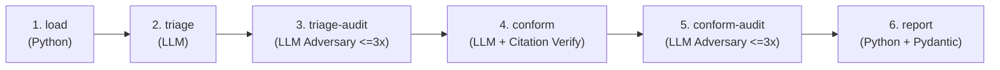

# ARMOR v6 (`armor-agent-plugin`)

**ARMOR** (**A**I **R**isk **M**anagement & **O**perational **R**esilience) is an LLM-driven AI-guardrail posture pipeline packaged as a Claude Code / Copilot plugin (`v6.0.0`).

It audits any codebase on disk against a **53-row catalog of AI & agentic standards**—normalised across the **EU AI Act**, **NIST AI RMF**, **MITRE ATLAS**, **OWASP Top 10 for LLM Applications (2025)**, and the **AI Incident Database (AIID / MIT AI Risk Repository)**—and produces a schema-validated posture report describing, per guardrail, whether the project implements it, backed by deterministically cross-verified `file:line` citations.

---

## Table of Contents

1. [Why ARMOR v6? Core Design Principles](#1-why-armor-v6-core-design-principles)
2. [6-Phase Pipeline Architecture](#2-6-phase-pipeline-architecture)
3. [Repository Layout](#3-repository-layout)
4. [Installation & Runtime Requirements](#4-installation--runtime-requirements)
5. [CLI Reference & Usage](#5-cli-reference--usage)
6. [Step-by-Step Disk-Queue Protocol Walkthrough](#6-step-by-step-disk-queue-protocol-walkthrough)
7. [Phase-by-Phase Deep Dive](#7-phase-by-phase-deep-dive)
   - [Phase 1: `load` (Deterministic Python)](#phase-1-load-deterministic-python)
   - [Phase 2: `triage` (LLM Applicability Profiling)](#phase-2-triage-llm-applicability-profiling)
   - [Phase 3: `triage-audit` (Adversarial Red-Team Loop)](#phase-3-triage-audit-adversarial-red-team-loop)
   - [Phase 4: `conform` (LLM Conformance & Citation Verification)](#phase-4-conform-llm-conformance--citation-verification)
   - [Phase 5: `conform-audit` (Adversarial Red-Team + Re-Verification)](#phase-5-conform-audit-adversarial-red-team--re-verification)
   - [Phase 6: `report` (Deterministic Rollup & Schema Validation)](#phase-6-report-deterministic-rollup--schema-validation)
8. [Citation Cross-Verification & Anti-Hallucination Engine](#8-citation-cross-verification--anti-hallucination-engine)
9. [Scoring, Weighting & Remediation Ranking](#9-scoring-weighting--remediation-ranking)
10. [The 12 Guardrail Families & 53 Sub-Guardrails](#10-the-12-guardrail-families--53-sub-guardrails)
11. [Catalog Subsystem & Content-Addressed Versioning](#11-catalog-subsystem--content-addressed-versioning)
12. [Agent Wrapper (`armor-agent`) & Verdict Contract](#12-agent-wrapper-armor-agent--verdict-contract)
13. [Output Directory Structure (`.armor/`)](#13-output-directory-structure-armor)
14. [Hard Invariants & Security Guarantees](#14-hard-invariants--security-guarantees)
15. [Testing & Verification](#15-testing--verification)

---

## 1. Why ARMOR v6? Core Design Principles

Traditional static regex scanners produce high false-positive noise and cannot reason about architectural intent, while unconstrained LLM code reviews hallucinate file paths, invent line numbers, and suffer from sycophantic confirmation bias.

ARMOR v6 solves both problems through two non-negotiable architectural properties:

1. **Zero Internal LLM API Calls (Disk-Queue Exchange)**:
   The calling IDE agent (Claude Code / GitHub Copilot) **is** the LLM. The Python runner never contacts Bedrock, OpenAI, Anthropic, or any external network service during an audit. Every LLM phase is a deterministic **disk-queue exchange**:
   - The Python runner writes `<run_dir>/queue/<phase>.request.json` containing the exact prompt instructions, input data, and required `response_schema`.
   - The agent inspects the repository, performs the analysis, and writes strict JSON to `<run_dir>/queue/<phase>.response.json`.
   - The Python runner validates the response, enforces all invariants, and writes the phase artifact.
2. **Deterministic Citation Cross-Verification**:
   Every non-gap conformance verdict (`implemented`, `partial`, `weak`) **must** carry at least one `relative/path.ext:line` or `relative/path.ext:start-end` citation. The Python runner resolves each citation beneath `project_root`, blocks `..` path traversal, checks file existence, and bounds line numbers against the actual line count of the file on disk. Any fabricated or out-of-bounds citation automatically **demotes** the guardrail verdict to `inconclusive`, marks `demoted_due_to_hallucination: true`, and logs an immutable incident record to `.armor/hallucination_log.jsonl`.

---

## 2. 6-Phase Pipeline Architecture

The pipeline consists of **6 sequential phases**: two pure-Python deterministic phases (`load`, `report`) bookending four LLM disk-queue phases (`triage`, `triage-audit`, `conform`, `conform-audit`), two of which are multi-round adversarial red-team loops bounded at `MAX_AUDIT_REVISIONS = 3`.



| # | Phase | Driver | Mode | Run-Dir Artifact | Purpose |
| :-: | :--- | :--- | :--- | :--- | :--- |
| **1** | `load` | Python | `one_shot` | `01_guardrails.json` | Resolve & normalise the 53-row AI standards catalog. |
| **2** | `triage` | LLM | `two_step` | `02_triage.{json,md}` | Profile the codebase and tag each of the 53 guardrails `applies`, `partial_scope`, or `n_a`. |
| **3** | `triage-audit` | LLM (Adversary) | `two_step` (loop `<= 3`) | `03_triage_audit.{json,md}` | Red-team every applicability decision (`CONFIRM`, `REVISE`, `INVESTIGATE`). |
| **4** | `conform` | LLM | `two_step` | `04_conformance.{json,md}` | Score in-scope guardrails, enforce concrete remediations, and cross-verify `file:line` citations. |
| **5** | `conform-audit` | LLM (Adversary) | `two_step` (loop `<= 3`) | `05_conformance_audit.{json,md}` | Red-team conformance verdicts & citations; re-verify all post-audit citations. |
| **6** | `report` | Python | `one_shot` | `06_report.json` + `reports/posture_*` | Join all phases, compute weighted coverage & ranked suggestions, and validate against `PostureReport`. |

---

## 3. Repository Layout

```text
armor-agent-plugin/
├── README.md                                  # Comprehensive project & technical documentation
├── .gitignore                                 # Ignores .armor/, __pycache__/, *.lock, etc.
├── .claude-plugin/
│   └── plugin.json                            # Plugin manifest (v6.0.0)
├── agents/
│   └── armor-agent.md                         # Thin delegation wrapper -> emits fenced YAML verdict
└── skills/
    └── armor/
        ├── SKILL.md                           # Agent-facing skill contract + mandatory telemetry gate
        ├── scripts/
        │   ├── armor_run.py                   # 4-line runpy launcher shim
        │   ├── armor/                         # Core runtime Python package
        │   │   ├── __init__.py                # __version__ = "6.0.0"
        │   │   ├── __main__.py                # `python -m armor` entry point
        │   │   ├── cli.py                     # `pipeline` subcommand dispatcher
        │   │   ├── file_lock.py               # Cross-platform exclusive file lock (stdlib only)
        │   │   └── pipeline/
        │   │       ├── __init__.py            # Public pipeline surface re-exports
        │   │       ├── state.py               # RunDir, phase order, citation verifier, fingerprint
        │   │       ├── load.py                # Phase 1: Catalog resolution & normalisation
        │   │       ├── triage.py              # Phase 2: System profile & applicability triage
        │   │       ├── adversary.py           # Shared red-team request & delta engine
        │   │       ├── triage_audit.py        # Phase 3: Applicability red-team loop
        │   │       ├── conform.py             # Phase 4: Conformance evaluation & citation check
        │   │       ├── conform_audit.py       # Phase 5: Conformance red-team loop + re-verify
        │   │       ├── report.py              # Phase 6: Rollup, coverage, suggestions, MD/JSON output
        │   │       ├── schema.py              # Pydantic v2 PostureReport models (extra="forbid")
        │   │       └── schemas/
        │   │           └── posture_report.schema.json  # Generated JSON Schema (byte-synced)
        │   └── catalog/                       # Offline catalog build subsystem (--update-catalog)
        │       ├── ai_standards_versioning.py # Content-addressed SHA256 version commit helper
        │       ├── refresh_catalog.py         # Umbrella orchestrator (5 downloaders + generator)
        │       ├── download_aiid_slim.py      # AI Incident Database GraphQL downloader
        │       ├── download_eu_ai_act_cellar.py # EU AI Act (CELEX 32024R1689) CELLAR downloader
        │       ├── download_mitre_atlas.py    # MITRE ATLAS YAML + JSON splits downloader
        │       ├── download_nist_ai_rmf.py    # NIST AI 100-1 & 600-1 PDF downloader
        │       ├── download_owasp_llm_top10.py # OWASP LLM Top 10 (2025) PDF downloader
        │       └── generate_guardrail_catalog.py # Normaliser -> 12 families / 53 sub-guardrails
        ├── references/
        │   ├── architecture.md                # Module-by-module architectural reference
        │   └── ai_standards/                  # Versioned 53-row catalog + standards metadata
        │       ├── _catalog/
        │       │   ├── latest.json            # Pinned pointer -> 2026-05-14__b1ed6db3
        │       │   └── versions/2026-05-14__b1ed6db3/
        │       │       ├── guardrail_matrix.json   # Consumed by Phase 1 load
        │       │       ├── guardrail_matrix.{md,csv}
        │       │       ├── guardrail_catalog.{json,md}
        │       │       ├── source_coverage.json
        │       │       └── manifest.json
        │       ├── eu-ai-act/                 # {latest.json, history.jsonl, versions/<v>/...}
        │       ├── nist-ai-rmf/               # {latest.json, history.jsonl, versions/<v>/...}
        │       ├── owasp-llm-top10/           # {latest.json, history.jsonl, versions/<v>/...}
        │       └── mitre-atlas/               # {latest.json, history.jsonl, versions/<v>/...}
        └── assets/
            └── tests/                         # 40-test pytest suite
                ├── conftest.py
                └── pipeline/
                    ├── _helpers.py
                    ├── test_state.py
                    ├── test_load.py
                    ├── test_triage.py
                    ├── test_triage_audit.py
                    ├── test_conform.py
                    ├── test_conform_audit_and_report.py
                    └── test_schema.py
```

---

## 4. Installation & Runtime Requirements

ARMOR requires **Python 3.9+** (tested up to Python 3.14 with Pydantic v2).

| Package | Used By | When Required |
| :--- | :--- | :--- |
| `pydantic` (`>=2.0`) | `armor/pipeline/schema.py` | **Always** (every pipeline run) |
| `requests` | `catalog/download_*.py` | Only when running `--update-catalog` |
| `pyyaml` | `catalog/download_mitre_atlas.py` | Only when running `--update-catalog` |
| `pytest` | `skills/armor/assets/tests/` | Running the test suite |

Everything else in the runtime uses the **Python standard library** (`argparse`, `json`, `pathlib`, `runpy`, `dataclasses`, `hashlib`, `re`, `datetime`, `shutil`, `subprocess`, `os`, `sys`, `tempfile`, `threading`, `contextlib`, and platform-selected `msvcrt` / `fcntl`).

```bash
pip install pydantic requests pyyaml pytest
```

---

## 5. CLI Reference & Usage

The package can be invoked either via the marketplace file-path launcher `skills/armor/scripts/armor_run.py` or as `python -m armor` when `skills/armor/scripts` is on `PYTHONPATH`.

```bash
# Check version
python skills/armor/scripts/armor_run.py --version
# -> armor 6.0.0
```

### `pipeline` Subcommand Flags

```text
python skills/armor/scripts/armor_run.py pipeline <project> [OPTIONS]
```

| Flag | Action | Description |
| :--- | :--- | :--- |
| `--phase {load,triage,triage-audit,conform,conform-audit,report}` | `store` | Run a specific pipeline phase. |
| `--finalize` | `store_true` | For two-step LLM phases: consume `queue/<phase>.response.json`, validate, and write the phase artifact (or advance the audit loop). |
| `--status` | `store_true` | Print the active run directory path and the current state of all 6 phases. |
| `--all` | `store_true` | Advance every phase runnable without an LLM, automatically finalizing any phase whose `.response.json` is already present, and stop at the first phase awaiting an LLM response. |
| `--catalog PATH` | `store` | Override the default `guardrail_matrix.json` (or `latest.json`) path in Phase 1 (`load`). |
| `--audit-model NAME` | `store` | Reserved model hint for adversary phases. |
| `--validate-report` | `store_true` | Validate `<project>/.armor/reports/posture_latest.json` against the Pydantic `PostureReport` contract and exit (`0` = valid, `1` = schema violation, `2` = missing file). |
| `--write-schema` | `store_true` | Regenerate `armor/pipeline/schemas/posture_report.schema.json` from `PostureReport.model_json_schema()` and exit. |

---

## 6. Step-by-Step Disk-Queue Protocol Walkthrough

Below is a complete end-to-end execution trace showing how an IDE agent (or developer) drives ARMOR against a target project at `/path/to/target-repo`:

### Step 1: Start a Fresh Run & Advance to Triage (`--all` or `--phase load`)

```bash
python skills/armor/scripts/armor_run.py pipeline /path/to/target-repo --all
```
Output:
```text
[load] wrote /path/to/target-repo/.armor/runs/2026-11-16T18-00-00Z/01_guardrails.json (53 guardrails)
[triage] request written: /path/to/target-repo/.armor/runs/2026-11-16T18-00-00Z/queue/triage.request.json
LLM must write response to: /path/to/target-repo/.armor/runs/2026-11-16T18-00-00Z/queue/triage.response.json
then run: python skills/armor/scripts/armor_run.py pipeline /path/to/target-repo --phase triage --finalize
[--all] stopped at triage: awaiting LLM response at /path/to/target-repo/.armor/runs/2026-11-16T18-00-00Z/queue/triage.response.json
```

### Step 2: Fulfill Phase 2 (`triage`)
1. The agent reads `queue/triage.request.json`.
2. The agent writes strict JSON to `queue/triage.response.json`.
3. Finalize Phase 2:
   ```bash
   python skills/armor/scripts/armor_run.py pipeline /path/to/target-repo --phase triage --finalize
   ```

### Step 3: Prepare & Fulfill Phase 3 (`triage-audit`)
1. Prepare the adversary audit request:
   ```bash
   python skills/armor/scripts/armor_run.py pipeline /path/to/target-repo --phase triage-audit
   ```
2. The agent reads `queue/triage-audit.request.json`, critiques each row (`CONFIRM`, `REVISE`, or `INVESTIGATE`), and writes `queue/triage-audit.response.json`.
3. Finalize Phase 3:
   ```bash
   python skills/armor/scripts/armor_run.py pipeline /path/to/target-repo --phase triage-audit --finalize
   ```
   - If the adversary issued `>= 1` `REVISE` and `revision < 3`, the runner updates the target rows, writes a bumped `triage-audit.request.json`, removes the old response, and prints:
     ```text
     [triage-audit] auditor requested revisions; new request written. Drop a fresh response at .../queue/triage-audit.response.json and re-run with --finalize.
     ```
   - Once converged (or at round 3), it writes `03_triage_audit.json` and `03_triage_audit.md`.

### Step 4: Prepare & Fulfill Phase 4 (`conform`)
1. Prepare the conformance request:
   ```bash
   python skills/armor/scripts/armor_run.py pipeline /path/to/target-repo --phase conform
   ```
2. The agent inspects the codebase for every applicable guardrail, attaches `relative/path.ext:line` citations and codebase-specific remediations, and writes `queue/conform.response.json`.
3. Finalize Phase 4:
   ```bash
   python skills/armor/scripts/armor_run.py pipeline /path/to/target-repo --phase conform --finalize
   ```

### Step 5: Prepare & Fulfill Phase 5 (`conform-audit`)
1. Prepare the conformance adversary request:
   ```bash
   python skills/armor/scripts/armor_run.py pipeline /path/to/target-repo --phase conform-audit
   ```
2. The agent red-teams the conformance rows (using only the cited `file:line` locations), writes `queue/conform-audit.response.json`, and finalizes:
   ```bash
   python skills/armor/scripts/armor_run.py pipeline /path/to/target-repo --phase conform-audit --finalize
   ```

### Step 6: Generate & Validate Phase 6 (`report`)
```bash
python skills/armor/scripts/armor_run.py pipeline /path/to/target-repo --phase report
python skills/armor/scripts/armor_run.py pipeline /path/to/target-repo --validate-report
```
Output:
```text
[report] wrote .../06_report.json and /path/to/target-repo/.armor/reports/posture_latest.md
ok: /path/to/target-repo/.armor/reports/posture_latest.json conforms to PostureReport schema
```

---

## 7. Phase-by-Phase Deep Dive

### Phase 1: `load` (Deterministic Python)
- **Module**: `skills/armor/scripts/armor/pipeline/load.py`
- **Catalog Resolution**:
  1. If `--catalog PATH` is provided, resolves `PATH` directly.
  2. Otherwise checks `<skill_root>/references/ai_standards/_catalog/latest.json` and resolves `versions/<version>/guardrail_matrix.json`.
  3. Falls back to walking parent directories for legacy `ai_standards/_catalog/latest.json`.
- **Normalisation**: Transforms each entry in `sub_guardrails` into:
  ```json
  {
    "sid": "GR-01.1",
    "family": "GR-01",
    "family_name": "Risk & impact assessment",
    "description": "...",
    "verification_test": "...",
    "applicability_hint": "...",
    "implementation_hints": "...",
    "standard_refs": "EU AI Act Art 6, 9, 27 | NIST GOVERN-1, MAP-1, MAP-3, MAP-5 | ATLAS AML.M0017 | MIT ..."
  }
  ```

### Phase 2: `triage` (LLM Applicability Profiling)
- **Module**: `skills/armor/scripts/armor/pipeline/triage.py`
- **Context Collection (`_system_profile_inputs`)**:
  - Reads up to the first `6,000` characters of any present manifest/documentation file: `README.md`, `README.rst`, `README.txt`, `pyproject.toml`, `package.json`, `pom.xml`, `build.gradle`, `Cargo.toml`, `go.mod`, `requirements.txt`, `Dockerfile`, `openspec/AGENTS.md`, `AGENTS.md`, `CLAUDE.md`.
  - Lists sorted top-level directory and file names (skipping dotfiles except `.github/`).
- **Validation**:
  - Ensures every loaded `sid` is present exactly once (no unknown, duplicate, or missing SIDs).
  - Enforces `status` in `{"applies", "partial_scope", "n_a"}` and non-empty `reason`.
  - Produces `02_triage.json` and `02_triage.md`.

### Phase 3: `triage-audit` (Adversarial Red-Team Loop)
- **Modules**: `adversary.py` + `triage_audit.py`
- **Allowed Verdicts**: `CONFIRM`, `REVISE`, `INVESTIGATE`.
- **Loop Semantics**:
  - When the adversary outputs `REVISE` for a row, `apply_deltas()` merges `revised_row` over the previous row (preserving `sid` and row order) and records a `{sid, critique, before, after}` entry in `revisions_applied`.
  - When the adversary outputs `INVESTIGATE`, `{sid, critique}` is appended to `open_questions`.
  - **Convergence**: Converges immediately when `len(revisions_applied) == 0`, or force-terminates at `revision == MAX_AUDIT_REVISIONS (3)` with `converged: false`.
  - Intermediate rounds persist to `.triage_audit_trail.json` and are cleaned up upon completion.

### Phase 4: `conform` (LLM Conformance & Citation Verification)
- **Module**: `skills/armor/scripts/armor/pipeline/conform.py`
- **Scope**: Includes only guardrails whose post-audit triage status is `applies` or `partial_scope` (`n_a` rows are excluded from LLM conformance evaluation).
- **Allowed Verdicts**: `implemented`, `partial`, `weak`, `gap`, `inconclusive`, `n/a`.
- **Non-Gap Verdicts (`NON_GAP`)**: `{"implemented", "partial", "weak"}` — **must** include `>= 1` verified citation.
- **Mandatory Remediation Rules**:
  For verdicts in `{"gap", "weak", "partial", "inconclusive"}`, `remediation` is mandatory and must be:
  1. **Codebase-specific**: Name real files/directories in the project and exact target paths for new artefacts.
  2. **Action-leading**: Start with an imperative verb (never `"Implement the guardrail"`).
  3. **Concrete**: Reference real entry points, functions, and config keys.
  4. **Anchored**: Directly satisfy the guardrail's `verification_test`.
  5. **Free of banned boilerplate phrases**: `"Implement the guardrail"`, `"Add CI enforcement + persistent audit trail"`, `"as appropriate"`, `"follow best practices"`.

### Phase 5: `conform-audit` (Adversarial Red-Team + Re-Verification)
- **Module**: `skills/armor/scripts/armor/pipeline/conform_audit.py`
- **Adversary Directions**:
  - *(a) DOWNGRADE rows whose evidence is weak or fabricated;*
  - *(b) UPGRADE rows you can defend with additional citations.*
  - The adversary may **not** invent new SIDs, change scope, or read source files beyond the `file:line` citations already present in the target rows.
- **Post-Delta Citation Re-Verification**:
  After applying adversary revisions in each round, the runner re-runs `verify_citation` across every row in `new_target`. If a revised `NON_GAP` row has no valid citations (or its new citations fail verification), the runner immediately demotes it to `inconclusive`, sets `demoted_due_to_hallucination = True`, logs the rejected citations to `hallucination_log.jsonl` with `"phase": "conform-audit"`, and records the count in `post_audit_hallucinations`.

### Phase 6: `report` (Deterministic Rollup & Schema Validation)
- **Modules**: `report.py` + `schema.py`
- Joins `01_guardrails.json`, `03_triage_audit.json`, and `05_conformance_audit.json` by `sid`.
- Guardrails tagged `n_a` in triage inherit `verdict = "n/a"`.
- Aggregates `open_questions` from both Phase 3 (`triage-audit`) and Phase 5 (`conform-audit`).
- Validates the assembled report dictionary against `schema.PostureReport` **before** writing bytes to disk (any schema drift aborts loudly).
- Writes:
  - `<run_dir>/06_report.json`
  - `<project>/.armor/reports/posture_<iso>.json` & `posture_<iso>.md`
  - `<project>/.armor/reports/posture_latest.json` & `posture_latest.md`

---

## 8. Citation Cross-Verification & Anti-Hallucination Engine

Implemented in `verify_citation(project, citation)` (`armor/pipeline/state.py`):

### Accepted Grammar
```regex
^([^:]+?)(?::(\d+))?(?:-(\d+))?$
```
Examples:
- `src/main.py` (whole file)
- `src/main.py:42` (single line)
- `src/main.py:10-25` (line range)

### Verification Algorithm
1. **Regex parse**: Strip whitespace and match against `_CITATION_RE`. No match -> `(False, "unparseable citation")`.
2. **Path confinement (`..` traversal protection)**: Resolve `(project / rel).resolve()` and check `p.relative_to(project.resolve())`. If `ValueError` is raised -> `(False, "citation escapes project_root")`.
3. **File existence**: Check `p.is_file()`. If missing -> `(False, "file not found")`.
4. **Whole-file citation**: If no `:line` part is given -> `(True, "ok")`.
5. **Line count check**: Read file (`utf-8`, `errors="replace"`) and count lines (`total`). If `OSError` -> `(False, "unreadable")`.
6. **Bounds check**: Let `lo = int(start)` and `hi = int(end) if end else lo`. If `lo < 1` or `hi < lo` or `hi > total` -> `(False, "line out of bounds (file has <total> lines)")`. Otherwise -> `(True, "ok")`.

### Hallucination Logging (`.armor/hallucination_log.jsonl`)
Every rejected citation in Phase 4 (`conform`) or Phase 5 (`conform-audit`) is appended to `<project>/.armor/hallucination_log.jsonl`:
```json
{"ts": "2026-11-16T18-00-00Z", "phase": "conform", "sid": "GR-01.1", "citation": "src/ghost.py:10", "reason": "file not found"}
```

---

## 9. Scoring, Weighting & Remediation Ranking

### Verdict Weights (`VERDICT_WEIGHT`)

| Verdict | Weight | Included in Coverage Denominator? |
| :--- | :---: | :---: |
| `implemented` | **1.0** | Yes |
| `partial` | **0.6** | Yes |
| `weak` | **0.3** | Yes |
| `gap` | **0.0** | Yes |
| `inconclusive` | **0.0** | Yes |
| `n/a` | — | **No** (excluded from denominator entirely) |

- **Overall Coverage (`overall_pct` & `applicable_only_pct`)**:
  $$\text{overall\_pct} = \text{round}\left(100 \times \frac{\sum_{r \in \text{in\_scope}} \text{VERDICT\_WEIGHT}[r.\text{verdict}]}{|\text{in\_scope}|},\ 1\right)$$
  (Returns `0.0` if `in_scope` is empty.)
- **Per-Family Rollup (`by_family`)**:
  Sorted ascending by `(score_pct, family)` so the **weakest guardrail families appear first**. Families where all guardrails are `n/a` are omitted from `by_family`.

### Remediation Suggestions Ranking (`_suggestions`)
All actionable rows (`verdict` in `{"gap", "inconclusive", "weak", "partial"}`) are ranked deterministically by:
1. **`-points_unlocked`** (`round(1.0 - VERDICT_WEIGHT[verdict], 2)` descending — so `gap` & `inconclusive` (`+1.0`) rank ahead of `weak` (`+0.7`) and `partial` (`+0.4`)).
2. **`family_score_pct`** (ascending — weakest family first).
3. **`_SUGGESTION_KIND_ORDER[verdict]`** (`gap: 0`, `inconclusive: 1`, `weak: 2`, `partial: 3`).
4. **`sid`** (lexicographical tie-breaker).

---

## 10. The 12 Guardrail Families & 53 Sub-Guardrails

| Family ID | Family Name | Sub-Guardrail Count | SIDs | Key Standards Mapped |
| :---: | :--- | :---: | :--- | :--- |
| **GR-01** | Risk & impact assessment | 5 | `GR-01.1` – `GR-01.5` | EU AI Act Art 6, 9, 13, 27, 43; NIST GOVERN-1/4, MAP-1/2/3/5, MANAGE-1..4 |
| **GR-02** | Data governance | 5 | `GR-02.1` – `GR-02.5` | EU AI Act Art 10, 15, 53; OWASP LLM02, LLM04, LLM08; ATLAS AML.M0006/7/14/18 |
| **GR-03** | Transparency & disclosure | 4 | `GR-03.1` – `GR-03.4` | EU AI Act Art 11, 13, 14, 50, 53; OWASP LLM09; NIST GOVERN-1/4, MAP-1, MEASURE-2 |
| **GR-04** | Human oversight | 4 | `GR-04.1` – `GR-04.4` | EU AI Act Art 14; NIST GOVERN-3, MAP-3, MANAGE-1..4; OWASP LLM06, LLM09, LLM10 |
| **GR-05** | Robustness & accuracy | 5 | `GR-05.1` – `GR-05.5` | EU AI Act Art 15, 43; NIST MEASURE-1/2/4, MANAGE-2/3; OWASP LLM05, LLM09, LLM10 |
| **GR-06** | Adversarial security | 5 | `GR-06.1` – `GR-06.5` | EU AI Act Art 15, 55; OWASP LLM01, LLM02, LLM05, LLM06, LLM07, LLM10; ATLAS AML.M0002/3/4/15/18/19 |
| **GR-07** | Privacy & data protection | 4 | `GR-07.1` – `GR-07.4` | EU AI Act Art 10, 12, 15; OWASP LLM02, LLM06; ATLAS AML.M0012, AML.M0018 |
| **GR-08** | Fairness & non-discrimination | 4 | `GR-08.1` – `GR-08.4` | EU AI Act Art 9, 10, 13, 14, 15, 27; NIST MAP-1/2, MEASURE-1/2; MIT 1.1 |
| **GR-09** | Content safety | 4 | `GR-09.1` – `GR-09.4` | EU AI Act Art 13, 15; OWASP LLM02, LLM05, LLM09; NIST GOVERN-4, MEASURE-2, MANAGE-2/3 |
| **GR-10** | Logging, monitoring & incident response | 5 | `GR-10.1` – `GR-10.5` | EU AI Act Art 12, 14, 19, 73; NIST GOVERN-1/3, MEASURE-2, MANAGE-4; ATLAS AML.M0016 |
| **GR-11** | Supply-chain & component integrity | 4 | `GR-11.1` – `GR-11.4` | EU AI Act Art 15, 53; OWASP LLM03, LLM05; ATLAS AML.M0007, AML.M0014 |
| **GR-12** | Agentic autonomy & action safety | 4 | `GR-12.1` – `GR-12.4` | EU AI Act Art 14, 15; OWASP LLM06, LLM10; ATLAS AML.M0018; MIT 5.2, 7.1, 7.4 |
| **Total** | **12 Families** | **53** | `GR-01.1` – `GR-12.4` | **5 Standards Frameworks** |

---

## 11. Catalog Subsystem & Content-Addressed Versioning

The offline catalog subsystem (`skills/armor/scripts/catalog/`) fetches public regulatory and technical standards and normalises them into `_catalog/versions/<date>__<sha8>/`.

- **Content-Addressed Versioning (`ai_standards_versioning.py`)**:
  Computes a deterministic SHA256 hash over all staged files (excluding `manifest.json`, which contains a non-deterministic `fetched_at` timestamp) by hashing `relpath + \0 + file_bytes` in sorted order.
  - If `latest.json["sha"] == sha`: discards the staged directory and appends a `status: "unchanged"` entry to `history.jsonl`.
  - Otherwise: moves the staged directory to `versions/<YYYY-MM-DD>__<sha8>/`, updates `latest.json`, and appends `status: "new"` or `"changed"` to `history.jsonl`.
- **Refresh Orchestrator (`refresh_catalog.py`)**:
  ```bash
  # Check if upstream standards have drifted (exit 0 = unchanged, 1 = drift)
  python skills/armor/scripts/catalog/refresh_catalog.py --check-only

  # Regenerate the 53-row catalog from local standards without hitting the network
  python skills/armor/scripts/catalog/refresh_catalog.py --skip-downloads

  # Full network refresh (runs all 5 downloaders + generator)
  python skills/armor/scripts/catalog/refresh_catalog.py
  ```

---

## 12. Agent Wrapper (`armor-agent`) & Verdict Contract

`agents/armor-agent.md` defines the `armor-agent` delegation wrapper. It routes arguments into the `armor` skill, enforces a **mandatory self-targeting guard**, and emits a deterministic fenced YAML verdict block.

### Self-Targeting Guard
If `<project_root>` resolves to `armor-agent-plugin`, `armor-agent`, or `plugins/armor-agent-plugin/` after path normalisation, `armor-agent` **refuses to run** and immediately emits `verdict: fail` with zeroed counts and:
```yaml
notes: "self-targeting refused: armor-agent cannot audit itself"
```

### Deterministic Verdict Rules (First Match Wins)

| Priority | Condition | Emitted Verdict |
| :---: | :--- | :---: |
| **1** | Any `gap` row (`posture.gap > 0`) **OR** `hallucinations.demoted_rows > 0` | `fail` |
| **2** | Pipeline aborted (any phase exited non-zero) | `fail` |
| **3** | Zero `gap` rows, but `>= 1` `weak` row **OR** `>= 1` `open_question` | `warn` |
| **4** | Only `implemented` / `partial` / `n/a` / `inconclusive` rows **AND** `0` hallucinations **AND** `0` open questions | `pass` |

---

## 13. Output Directory Structure (`.armor/`)

ARMOR is strictly read-only on the target project outside `<project_root>/.armor/`:

```text
<project_root>/.armor/
├── runs/<YYYY-MM-DDTHH-MM-SSZ>/
│   ├── 01_guardrails.json               # Phase 1 output (53 normalised rows)
│   ├── 02_triage.json                   # Phase 2 output (system_profile + applicability)
│   ├── 02_triage.md                     # Human-readable triage summary
│   ├── 03_triage_audit.json             # Phase 3 output (converged applicability + audit_trail)
│   ├── 03_triage_audit.md               # Human-readable triage audit trail
│   ├── 04_conformance.json              # Phase 4 output (verdicts + verified/rejected citations)
│   ├── 04_conformance.md                # Human-readable conformance table (*demoted* markers)
│   ├── 05_conformance_audit.json        # Phase 5 output (post-audit rows + audit_trail)
│   ├── 05_conformance_audit.md          # Human-readable conformance audit trail
│   ├── 06_report.json                   # Phase 6 Pydantic-validated PostureReport
│   ├── .triage_audit_trail.json         # Transient state (present only mid-Phase 3 loop)
│   ├── .conform_audit_trail.json        # Transient state (present only mid-Phase 5 loop)
│   └── queue/
│       ├── <phase>.request.json         # Written by Python runner
│       └── <phase>.response.json        # Written by LLM agent (unlinked after audit convergence)
├── reports/
│   ├── posture_<YYYY-MM-DDTHH-MM-SSZ>.json
│   ├── posture_<YYYY-MM-DDTHH-MM-SSZ>.md
│   ├── posture_latest.json              # Latest validated PostureReport JSON
│   └── posture_latest.md                # Latest full Markdown posture report
└── hallucination_log.jsonl              # Append-only log of all rejected/fabricated citations
```

---

## 14. Hard Invariants & Security Guarantees

1. **No External LLM Calls**: The Python runner never contacts an external LLM or network endpoint; all LLM interactions occur through local `.request.json` / `.response.json` files.
2. **Mandatory Citation Cross-Verification**: Every `NON_GAP` (`implemented`, `partial`, `weak`) verdict without at least one verified citation under `project_root` is automatically demoted to `inconclusive` and logged to `hallucination_log.jsonl`.
3. **Bounded Adversarial Loops**: `triage-audit` and `conform-audit` are strictly bounded at `MAX_AUDIT_REVISIONS = 3`; unresolved disputes surface as `open_questions`.
4. **Pre-Write Schema Enforcement**: `06_report.json` and `posture_latest.json` are validated against `PostureReport` (`extra="forbid"`) before bytes hit disk.
5. **Byte-Synchronized JSON Schema**: `posture_report.schema.json` is enforced by tests to be byte-identical to `PostureReport.model_json_schema()`.
6. **Path Confinement**: Only `<project_root>/.armor/` is written under the target repository, and `..` traversal in citations is rejected via `Path.relative_to()`.
7. **Self-Targeting Prevention**: `armor-agent` refuses to audit itself.

---

## 15. Testing & Verification

ARMOR ships with a 40-test `pytest` suite under `skills/armor/assets/tests/` covering every phase, invariant, error condition, hallucination demotion path, audit loop convergence/force-termination, and Pydantic schema constraint.

```bash
python -m pytest skills/armor/assets/tests -v
```

### Test Coverage Breakdown (40 Tests)

| Test Module | Tests | Behaviours Verified |
| :--- | :---: | :--- |
| `test_state.py` | **10** | Canonical `PHASES` tuple; `new_run`/`current_run` round-trip; fresh `pending` status; `require_phase_done` guard; file, line, and range citation verification; out-of-bounds line rejection; missing file rejection; `..` path traversal blocking; `project_fingerprint` change detection on edit. |
| `test_load.py` | **3** | Normalisation of SIDs, families, and `family_name`; artifact persistence equality; explicit `--catalog` path resolution. |
| `test_triage.py` | **5** | Request generation with all SIDs + `README.md` manifest preview + `response_schema`; happy-path JSON/MD output and `by_status` counts; rejection of unknown SID, missing SID, and invalid status. |
| `test_triage_audit.py` | **3** | Immediate round-1 convergence on all `CONFIRM`; 2-round convergence after a `REVISE` delta (`audit_trail` length 2); force-termination at `MAX_AUDIT_REVISIONS = 3` with `converged: False`. |
| `test_conform.py` | **4** | Exclusion of `n_a` rows from `in_scope`; valid citation retention; bogus citation demotion to `inconclusive` + `hallucination_log.jsonl` append; rejection of out-of-scope SIDs. |
| `test_conform_audit_and_report.py` | **6** | Adversary `REVISE` downgrade (`implemented` -> `weak`); adversary `REVISE` with fabricated citation auto-demoted to `inconclusive`; Phase 6 report join + `posture_latest.{json,md}` pointers; 50% coverage calculation & `n/a`-only family exclusion; suggestion ranking by `points_unlocked` (`+1.0` before `+0.7`, 15% mixed coverage); `open_questions` aggregation. |
| `test_schema.py` | **9** | `PostureReport` validation (`overall_pct == 50.0`); rejection of unknown top-level keys, unknown row keys, invalid verdicts, malformed `generated_at` timestamps, and out-of-range percentages; zero-drift validation of persisted report; schema persistence (`title == "PostureReport"`); byte-equality between packaged `posture_report.schema.json` and `PostureReport.model_json_schema()`. |

---

## Author & Attribution

- **Artifact**: `armor-agent-plugin` (`v6.0.0`)
- **Author**: Aveek Sengupta (`aveekforyou@gmail.com`)
